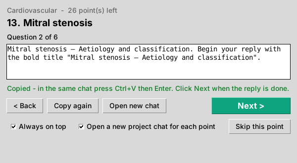

# Autocreate GPT project chats

Work through the state exam syllabus in your ChatGPT Projects: **one chat per syllabus point**, with the
same six questions asked in each chat:

```
Cardiology project
 ├─ chat "Mitral stenosis"   → Definition · Aetiology and classification · Pathogenesis ·
 ├─ chat "Mitral regurgitation"     Physical examination and signs and symptoms · Diagnosis ·
 ├─ chat "Endocarditis"             Management and treatment
 └─ … one per syllabus point (Cardiology = points 13–38)
```

## The prompt helper

A small window stays on top of your browser. It does all the bookkeeping and typing of questions;
you just paste and send:

1. The helper opens a **new chat in your project** and puts the first question on the clipboard.
2. In ChatGPT, click the message box, press **Ctrl+V**, then **Enter**.
3. When the reply has finished, click **Next** in the helper. The next question is copied right away.
4. After the 6th question, Next opens a new chat for the next syllabus point.

Nothing inside ChatGPT is automated, because you send every message yourself, so ChatGPT's
"verify you are human" checks don't come up. Progress is saved after every click: close the window
any time, and next time it carries on from the same question.



## Setup (Windows)

1. **Python 3**: install it from https://www.python.org/downloads/ and tick **"Add Python to PATH"**.
   Nothing else needs installing.
2. Download this repo (green **Code** button → **Download ZIP**) and unzip it.
3. Open your **Cardiology** project in ChatGPT and copy the address bar (it looks like
   `https://chatgpt.com/g/g-p-…/project`). Right-click **`Prompt Helper Cardiology.bat`** → *Edit*, paste
   the address into the `PROJECT_URL=` line, and save.
4. Double-click **`Prompt Helper Cardiology.bat`**.

**Tips:**
- **Points you've already done by hand** (e.g. Endocarditis): click **Skip this point**, or put
  `--points 13-16,18-38` on the `OPTIONS=` line.
- **Clicked Next too early?** Click **< Back**. The previous question is copied again.
- **Shortcut:** **Ctrl+Enter** in the helper window does the same as Next.
- **Starting a point again:** to start a point again from question 1, run
  `py -3 prompt_helper.py --section cardiovascular --reset 17`.
- **Making the cards:** keep GPT-to-Anki's `Watch Cardiology.bat` running and click Copy under each reply,
  and the cards go straight into Anki.

## Other projects

Copy `Prompt Helper Cardiology.bat`, rename it (e.g. `Prompt Helper Pulmonology.bat`), and change two lines:

- `SECTION=`: one of the files in the `syllabus` folder: `pulmonary`, `cardiovascular`, `rheumatic`,
  `hematologic`, `endocrine_metabolic`, `gastrointestinal`, `renal`, `toxicology_allergy`, `oncologic`,
  `treatment_principles`
- `PROJECT_URL=`: that ChatGPT project's address

## Editing what it asks

- **`syllabus/*.txt`**: one line per chat, taken from the state exam synopsis. Text after `=>` is the short
  name used in the questions (e.g. `13. Diseases of the mitral valve: mitral stenosis => Mitral stenosis`).
  Cardiology already has short names that match your Anki subdecks. For the other sections, add `=> Name`
  wherever the syllabus wording is too long for a question.
- **`prompts.txt`**: the six questions, one per line. `{topic}` is the short name, `{full}` the full
  syllabus wording, `{number}` the point number. Add, remove or reword lines as you like.

## Automatic mode (not recommended)

`syllabus_prompter.py` can drive Chrome by itself to send the questions. In practice ChatGPT detects this
and keeps showing "Verify you are human" checks, and it goes against OpenAI's terms. So it has no
launcher any more and isn't supported; use the prompt helper instead.

## Tests

```bash
pip install playwright
python -m unittest discover -s tests
```

The helper's window test needs tkinter and a display (skipped otherwise). The automatic-mode tests drive a
local fake ChatGPT page with Chromium and are skipped if Playwright/Chromium is missing.
